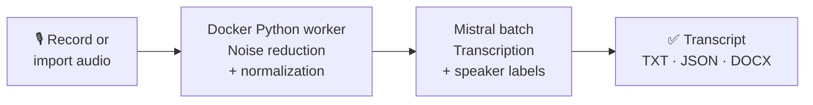
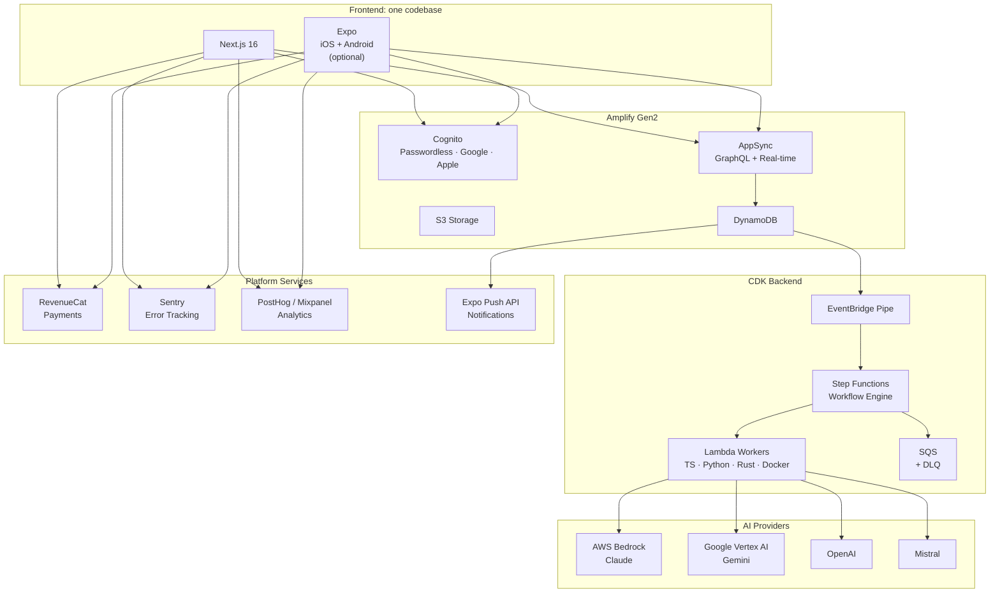

# Bootwright

> Stop vibe coding. Start shipping.

The foundations are laid. You're the architect. AI builds.

AI-native SaaS boilerplate: AWS Amplify + CDK, Next.js, Expo. The hard architectural problems are solved before you clone, and two complete working apps show the result.

[**→ Get the full source code: $349**](https://codecrafter.fr/en/bootwright)

---

## Sound familiar?

- A week configuring Google & Apple auth before the first user can log in
- Three days wiring DynamoDB to GraphQL, still debugging why real-time updates don't propagate
- Rebuilding cache invalidation and optimistic delete logic for each screen because nothing is shared
- No single billing system that works across web, iOS, and Android without three separate integrations
- A user loses credits because a backend job failed and there's no automatic refund path
- `.env` files on the repo because proper secret management was going to take another week
- Push notifications broken in production because an APNs certificate expired at 2am
- No Mac in the team but the iOS app needs to go to the App Store
- Users landing on the wrong screen because cold start dropped the deep link
- Calling an AI API once per item in real time, paying full rate, with no recovery when one fails midway
- An async AI workflow failing silently at step 4: spinner on screen, error in CloudWatch, quota consumed
- Your AI agent writes code fast, then skips the tests and the security review because nobody asked

---

## Why Bootwright

### AI-native

Bootwright is set up for AI coding agents from the first prompt, with Claude Code and Codex both supported.

A single `AGENTS.md` file gives the agent the whole project context: architecture rules, conventions, type rules, deployment constraints. Claude Code and Codex read the same file, so switching tools doesn't mean rewriting instructions. Each workspace (web, mobile, backend) has its own `AGENTS.md` with the rules that apply there.

Four quality agents ship ready to use for both tools: test writer, code reviewer, security reviewer, linter. In Claude Code, a plan-mode hook checks every implementation plan before you can approve it. If the plan doesn't schedule tests, review and lint (plus a security review when it touches auth, uploads, payments or user data), Claude has to fix the plan first.

On GitHub, Claude reviews every pull request and answers `@claude` mentions in issues and PRs. CI runs lint, tests and type checks on every push and pull request. A git hook writes Conventional Commits messages with Claude or Codex and rejects badly formatted ones.

### $0 if 0 users

AWS, PostHog, RevenueCat: all pay-as-you-go. No Vercel bill while you validate the idea. No Supabase plan, no Firebase costs. AWS Free Tier covers 1M auth requests/month, 25 GB storage, free Lambda invocations. If the launch goes nowhere, you spent $0. If it takes off, costs grow with revenue.

### Opinionated

Framework, cloud, payments, AI providers, linting: all pre-chosen. Fork and build immediately.

The infrastructure also survives refactoring. Every Lambda, IAM role and log group has a stable AWS identifier, so renaming a construct in code doesn't recreate the resource in production. The kind of thing you discover the hard way.

### Web + Mobile

One monorepo, one deploy pipeline. Next.js for web, Expo for iOS and Android. Auth, TypeScript types and business logic are shared, so a feature is built once and works on every platform. No parallel implementations to maintain, no drift between platforms.

Mobile is optional. Transcribe, the second included app, is web-only: its mobile app and push notifications were removed in a single commit.

---

## Production-grade backend

A workflow engine built on AWS Step Functions runs multi-step AI jobs. Adding a step to a workflow takes one line.

| | |
|---|---|
| **Workflow engine** | Sequential steps, parallel branches and loops over lists. Every step gets the same payload format, 3 automatic retries and error handling. |
| **Credits protected both ways** | If a job fails before delivering its result, the user's credits are refunded automatically before the job is marked as failed. Once the result is delivered, a later failure never refunds and never shows an error to the user; your team gets an alert email instead. |
| **No double processing** | A replayed event never starts the same job twice. Status and credit updates are conditional writes, so a stale update is rejected instead of overwriting a newer one. |
| **Errors users can read** | When a job fails, a structured error goes all the way back to the app. The user sees what happened instead of an endless spinner. |
| **Workers in 3 languages** | TypeScript, Python and Rust on ARM64 (Graviton), plus Python packaged as a Docker image for heavy processing such as audio or ML. Same naming, logging and tracing for all of them. |
| **Dead letter queues everywhere** | Every async path has a dead letter queue with a CloudWatch alarm. You find out before your user does. |
| **Real-time or batch** | Run AI jobs one by one in real time, or send them to a provider batch API for about 50% less. The same waiting mechanism works with Vertex AI, OpenAI and Mistral batch jobs, and no Lambda stays running during multi-hour jobs. |
| **AI cost per feature** | Bedrock calls go through one inference profile per feature, so your AWS bill shows what each feature costs. |
| **Prompt safety** | User text sent to the LLM is screened for prompt injection, and model refusals are detected instead of being passed on as results. |
| **Observability from day 1** | X-Ray tracing, CloudWatch alarms on dead letter queues, workflows and HTTP APIs, SNS email alerts, Sentry (crashes + session replay), PostHog or Mixpanel. |

---

## Two working apps included

Bootwright ships with two working apps built on the same foundations. Use them as references, or start from the one closest to your product.

### PhotoCV: professional photos from selfies

PhotoCV turns 1 to 3 selfies into professional photos for a resume, LinkedIn or an ID. It runs on web, iOS and Android from the same codebase.

What it shows: passwordless auth, S3 upload with progress, multi-LLM orchestration, real-time and batch generation, push notifications, a credits system with an in-app paywall when credits run out, in-app content reporting, real-time subscriptions, i18n in 5 languages and dark mode.

### Transcribe: audio to speaker-aware transcripts

Transcribe turns recorded or uploaded audio into a transcript with timestamps and speaker labels. It is a web app.

What it shows: in-browser recording with microphone selection, heavy audio processing in a container Lambda, long recordings split into chunks, a provider batch API driven by the workflow engine, one-time minute packs (120, 600 or 6,000 minutes) charged on the real audio duration, and export to TXT, JSON or DOCX.

### Same foundations, different product

PhotoCV turns photos into images and Transcribe turns audio into text, yet both run on the same workflow engine, worker factories, credit and refund logic, monitoring, auth and AI tooling. Building Transcribe from PhotoCV meant writing a new workflow, new workers and a new UI; the infrastructure code stayed the same, much of it file for file.

---

## How Bootwright compares

| | Bootwright | Other solutions |
|---|---|---|
| **$0 at start** | AWS Free Tier, fully pay-as-you-go. No fixed costs. | Hosting costs from day one |
| **AWS Serverless** | Serverless, scalable, affordable. Fast start with Amplify. | Locked to Vercel / Supabase / Firebase |
| **Extensible infrastructure** | Full AWS power via CDK: SageMaker, dedicated infra, GPU. Anything is possible. | Limited to provider's offerings |
| **Multi-provider AI** | AWS Bedrock, Google Vertex AI, OpenAI, Mistral, plus a template for any OpenAI-compatible provider | Locked into one ecosystem |
| **Native Mobile** | Expo React Native: iOS and Android, optional | Web only |
| **Built for AI coding agents** | `AGENTS.md` for Claude Code and Codex, quality agents required in every plan, Claude PR review | No AI dev integration |

---

## Architecture

## Tech Stack

| Layer | Technologies |
|---|---|
| **Web** | Next.js 16 (App Router), React 19, TanStack Query, Zustand, shadcn/ui, Tailwind CSS 4 |
| **Mobile** | Expo SDK 54 (React Native), Expo Router, React Native Paper |
| **Auth** | AWS Cognito: passwordless OTP + Google OAuth + Apple OAuth |
| **Client backend** | AWS Amplify Gen2: AppSync/GraphQL, DynamoDB, S3 |
| **AI backend** | AWS CDK: Step Functions, Lambda on ARM64 (Node.js 24 · Python 3.12 · Rust · Docker) |
| **AI providers** | AWS Bedrock (Claude) · Google Vertex AI (Gemini) · OpenAI · Mistral · OpenAI-compatible template |
| **Payments** | RevenueCat: iOS, Android, Web. Subscriptions, consumable credits, one-time packs |
| **Push notifications** | Expo Push API: DynamoDB Streams → SQS FIFO → Lambda |
| **Analytics** | PostHog, Mixpanel or none (one config value) |
| **Error tracking** | Sentry: crashes, performance traces, session replay |
| **Monitoring** | CloudWatch alarms, X-Ray tracing, SNS email alerts |
| **Caching** | TanStack Query: IndexedDB (web), AsyncStorage (mobile), offline-first images |
| **i18n** | English, French, German, Spanish, Italian |
| **Code quality** | Biome + Ruff, Vitest + pytest, TypeScript strict mode, CI on every push |

---

## What's Included

**Authentication:** Passwordless email OTP, Google and Apple OAuth on web and mobile. Unified sign-in/sign-up flow. Test accounts for App Store and Google Play review. Legal pages (Privacy Policy, ToS, Data Deletion) ready for store submission.

**Data & Storage:** GraphQL API with real-time subscriptions. Owner-based access control. S3 with identity-based permissions and lifecycle rules. TTL auto-deletion, Point-in-Time Recovery, deletion protection.

**User isolation:** Each user's files live under an identity the server derives from their login, which the app can read but never change. The backend checks that path before processing anything, so a user can't get someone else's files processed.

**Secrets:** API keys are stored encrypted in AWS SSM Parameter Store. Each Lambda can only read the keys it needs, and no key ever appears in code, config files or environment variables.

**AI Orchestration:** Multi-LLM workflows with sequential steps, parallel branches and loops. Bedrock, Vertex AI, OpenAI, Mistral, plus a template for any OpenAI-compatible provider. Real-time or batch (about 50% cheaper).

**Payments & Quotas:** RevenueCat across iOS, Android and Web. Subscriptions, consumable credits and one-time packs. Automatic refund when a job fails before delivery. Plans and costs set in `config.json`.

**Push Notifications:** DynamoDB Streams → SQS FIFO → Lambda. Automatic receipt verification. Invalid token cleanup.

**Analytics:** PostHog or Mixpanel, or none, switched with one config value. Optional cookieless mode, tracking limited to signed-in users, and a reverse proxy so ad blockers don't drop events.

**Developer Experience:** `AGENTS.md` project context for Claude Code and Codex. Four quality agents, required in every Claude Code plan. Claude PR review and `@claude` in GitHub. CI with lint, tests and type checks. AI-generated Conventional Commits. 45+ pages of documentation.

**Observability:** Structured logging, X-Ray tracing, CloudWatch alarms, SNS alerts, Sentry, PostHog or Mixpanel. All wired on day 1.

---

## Ship your SaaS, not your infrastructure

**$349, one-time purchase, lifetime updates.**

Auth, payments, AI orchestration, push notifications and observability are already done. Clone, configure your keys, deploy. Build the product only you can build.

Complete monorepo (Next.js + Expo + CDK) · PhotoCV and Transcribe apps · `AGENTS.md` + AI agent pipeline for Claude Code and Codex

[**→ Get Bootwright**](https://codecrafter.fr/en/bootwright)

---

[Bootwright](https://codecrafter.fr/en/bootwright) · Last updated: 2026-11-11
