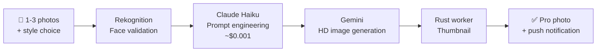
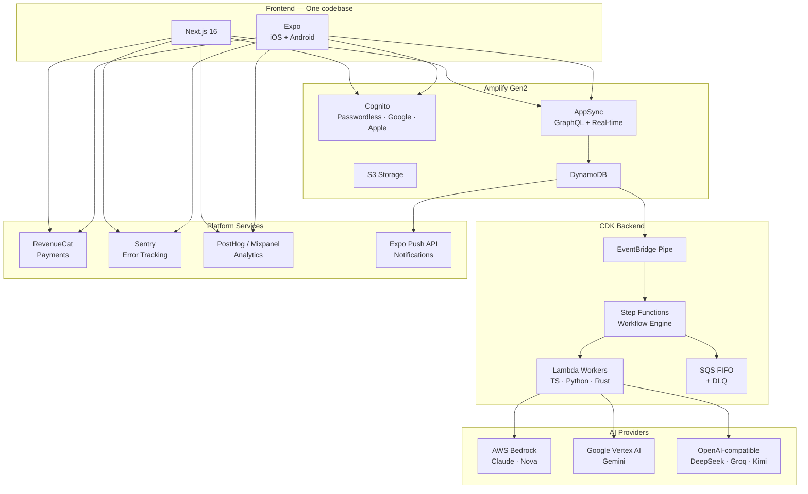

# Bootwright

> Stop vibe coding. Start shipping.

The foundations are laid. You're the architect. AI builds.

AI-native SaaS boilerplate: AWS Amplify + CDK, Expo, Next.js. Every hard architectural problem solved before you clone.

[**→ Get the full source code: $349**](https://codecrafter.fr/en/bootwright)

---

## Sound familiar?

- A week configuring Google & Apple auth before the first user can log in
- Three days wiring DynamoDB to GraphQL, still debugging why real-time updates don't propagate
- Rebuilding cache invalidation and optimistic delete logic for each screen because nothing is shared
- No single billing system that works across web, iOS, and Android without three separate integrations
- A user loses credits because a backend job failed and there's no automatic refund path
- `.env` files on the repo because proper secret management was going to take another week
- Push notifications broken in production because an APNs certificate expired at 2am
- No Mac in the team but the iOS app needs to go to the App Store
- Users landing on the wrong screen because cold start dropped the deep link
- Calling an AI API once per item in real time, paying full rate, with no recovery when one fails midway
- An async AI workflow failing silently at step 4: spinner on screen, error in CloudWatch, quota consumed

---

## Why Bootwright

### AI-native

You started a long task and left. You came back 15 minutes later and Claude Code had stopped after 30 seconds, waiting for you to approve a bash command. Or you ran `--dangerously-skip-permissions` so it wouldn't block, and it deleted a config file.

Bootwright ships with a `permission-check` hook: every permission request is evaluated by Claude itself before it reaches you. Safe operations are approved automatically. Dangerous ones (force pushes to main, `rm -rf` on sensitive paths, credential exposure) are blocked with a specific reason. You leave. Claude works. No bypass needed.

Beyond that: `CLAUDE.md` gives Claude full project context from the first prompt: architecture, conventions, constraints, type rules. It codes like it's known your stack for months. Four quality gate agents run automatically after each significant change: test creation, code review, security scan, lint. Claude reviews every pull request in CI. A second-opinion hook consults an independent model before exiting plan mode.

No other SaaS boilerplate is built for Claude Code.

### $0 if 0 users

AWS, PostHog, RevenueCat: all pay-as-you-go. No Vercel bill while you validate the idea. No Supabase plan, no Firebase costs. AWS Free Tier covers 1M auth requests/month, 25 GB storage, free Lambda invocations. If the launch goes nowhere, you spent $0. If it takes off, costs scale with revenue, not with infrastructure choices made before you had a single user.

### Opinionated

Framework, cloud, payments, AI providers, linting: all pre-chosen. Zero analysis paralysis. Fork and build immediately.

Infrastructure choices that survive refactoring too: CDK logical ID stabilization on every Lambda, IAM role, and log group means renaming a construct doesn't recreate the AWS resource in production. The kind of thing you discover the hard way.

### Web + Mobile

One monorepo, one deploy pipeline. Next.js for web, Expo for iOS and Android. Auth logic, TypeScript types, and business logic shared across all three. Build a feature once, it works everywhere. No parallel implementations to maintain, no drift between platforms.

---

## Production-grade backend

Custom CDK workflow engine built on Step Functions. Multi-step AI orchestration in one function call.

| | |
|---|---|
| **Workflow engine** | `createStep / createMapStep / createMergeStep`: each Lambda wrapped with standard payload, 3× retry, FormatError catch, and error handler. New AI workflow step = one line. |
| **Error chain, structurally enforced** | `RefundQuota → UpdateStatusError → WorkflowFailed` wired at the Step Functions level. Refund fires before the workflow is marked failed. Not application-level try/catch. |
| **Lambda factory, 3 runtimes** | `createNodejsWorker / createPythonWorker / createRustWorker`: TypeScript, Python, Rust on ARM64 Graviton. Same naming convention, log group, X-Ray tracing across all three. |
| **DLQ everywhere** | Every async path has a dead letter queue with a CloudWatch alarm. You find out before your user does. |
| **Dual-mode AI processing** | Real-time single workflow + Vertex AI Batch (~50% cheaper). SQS `WAIT_FOR_TASK_TOKEN`. No Lambda held open during multi-hour jobs. |
| **Bedrock inference profiles** | Cost attribution per feature. No black-box AWS bills. |
| **Observability from day 1** | X-Ray tracing, CloudWatch alarms on DLQs + Step Functions + HTTP, SNS email alerts, Sentry (crashes + session replay), PostHog or Mixpanel. |

---

## Demo App: PhotoCV

The boilerplate ships with **PhotoCV**, a working app that generates professional photos (resume, LinkedIn, ID) from selfies. Every feature of the stack exercised in production.

**What it demonstrates**: Passwordless auth, S3 upload with progress, multi-LLM orchestration via Step Functions, push notifications, quota/credits system, real-time subscriptions, i18n (5 languages), dark mode — on both web and mobile from the same codebase.

---

## How Bootwright compares

| | Bootwright | Other solutions |
|---|---|---|
| **$0 at start** | AWS Free Tier, fully pay-as-you-go. No fixed costs. | Hosting costs from day one |
| **AWS Serverless** | Serverless, scalable, affordable. Fast start with Amplify. | Locked to Vercel / Supabase / Firebase |
| **Extensible infrastructure** | Full AWS power via CDK: SageMaker, dedicated infra, GPU. Anything is possible. | Limited to provider's offerings |
| **Multi-provider AI** | Bedrock, Vertex AI, any OpenAI-compatible provider. Connect wherever you want. | Locked into one ecosystem |
| **Native Mobile** | Expo React Native: iOS and Android | Web only |
| **Claude Code integrated** | `CLAUDE.md` + permission hooks + quality pipeline | No AI dev integration |

---
## Architecture

## Tech Stack

| Layer | Technologies |
|---|---|
| **Web** | Next.js 16 (App Router), TanStack Query, Zustand, shadcn/ui, Tailwind CSS 4 |
| **Mobile** | Expo (React Native), Expo Router |
| **Auth** | AWS Cognito: passwordless OTP + Google OAuth + Apple OAuth |
| **Client backend** | AWS Amplify Gen2: AppSync/GraphQL, DynamoDB, S3 |
| **AI backend** | AWS CDK: Step Functions, Lambda on ARM64 (TypeScript · Python · Rust) |
| **AI providers** | AWS Bedrock (Claude, Nova) · Google Vertex AI (Gemini) · OpenAI-compatible (Kimi, DeepSeek, Groq, Qwen) |
| **Payments** | RevenueCat: iOS, Android, Web. Subscriptions + consumable credits |
| **Push notifications** | Expo Push API: DynamoDB Streams → SQS FIFO → Lambda |
| **Analytics** | PostHog or Mixpanel (switchable via config) |
| **Error tracking** | Sentry: crashes, performance traces, session replay |
| **Monitoring** | CloudWatch alarms, X-Ray tracing, SNS email alerts |
| **Caching** | TanStack Query: IndexedDB (web), AsyncStorage (mobile), offline-first images |
| **i18n** | English, French, German, Spanish, Italian |
| **Code quality** | Biome, Vitest, TypeScript strict mode |

---

## What's Included

**Authentication:** Passwordless email OTP, Google and Apple OAuth on web and mobile. Unified sign-in/sign-up flow. Legal pages (Privacy Policy, ToS, Data Deletion) ready for App Store submission.

**Data & Storage:** GraphQL API with real-time subscriptions. Owner-based access control. S3 with identity-based permissions and lifecycle rules. TTL auto-deletion, Point-in-Time Recovery, deletion protection.

**AI Orchestration:** Multi-LLM Step Functions workflows (sequential + parallel branches). Bedrock + Vertex AI + any OpenAI-compatible provider. Workload Identity Federation: zero API keys in code. Dual-mode: real-time or batch (~50% cheaper).

**Payments & Quotas:** RevenueCat across iOS, Android, Web. Subscriptions and consumable credits. Automatic quota refund on processing failure. Configurable per plan in `config.json`.

**Push Notifications:** DynamoDB Streams → SQS FIFO → Lambda. Automatic receipt verification. Invalid token cleanup.

**Developer Experience:** `CLAUDE.md` with full project context. Permission-check hook for unattended autonomous sessions. 4 automated quality gate agents. Claude PR review in CI. Auto-generated Conventional Commits.

**Observability:** Structured logging, X-Ray tracing, CloudWatch alarms, SNS alerts, Sentry, PostHog or Mixpanel. All wired on day 1.

---

## Ship your SaaS, not your infrastructure

**$349, one-time purchase, lifetime updates.**

Auth, payments, AI orchestration, push notifications, observability — solved. Clone, configure your keys, deploy. Build the product only you can build.

Complete monorepo (Next.js + Expo + CDK) · PhotoCV demo app · CLAUDE.md + AI agent pipeline

[**→ Get Bootwright**](https://codecrafter.fr/en/bootwright)

---

[Bootwright](https://codecrafter.fr/en/bootwright) · Last updated: 2026-02-21
